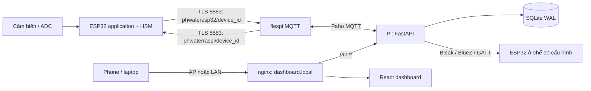

# pH Monitor — dashboard trên Raspberry Pi 4

Dashboard responsive cho điện thoại/laptop, nhận **dữ liệu thật** từ ESP32 qua flespi MQTT, lưu lịch sử trên Raspberry Pi và provision Wi-Fi ESP32 bằng BLE của Pi. Không còn dữ liệu demo hoặc fallback sang số đo giả.

**pH đang dùng hệ số hiệu chuẩn tạm:** `pH = 7 − 5,70 × (V_PO − 2,50)`, giới hạn 0–14. ESP32 tính từ điện áp PO đo thật, gửi pH dạng số và `calibrated: false`; UI ghi **pH tạm · Chưa hiệu chuẩn**. Công thức/hệ số tại `../src/01_application/hsm/sensor/ph_calibration.h` để thay sau khi hiệu chuẩn thực tế. Không gửi một giá trị pH cố định.

Pi dùng cùng công thức trong `backend/ph_calibration.py` khi firmware cũ gửi `ph: null` nhưng có điện áp hợp lệ và không báo lỗi sensor. Nếu ESP32 đã gửi pH thì Pi giữ nguyên giá trị, không quy đổi lại. Biểu đồ mặc định hiển thị pH, có nút chuyển sang điện áp.

## Truy cập trạm đang triển khai

- Web: <http://dashboard.local/>; trong AP có thể dùng <http://dashboard.lan/> hoặc <http://10.42.0.1/>.
- LAN hiện tại: <http://192.168.1.16/>.
- Wi-Fi AP: `raspi-haianh`; Pi giữ IP AP `10.42.0.1/24`, DHCP cấp `.20–.200`.
- Pi dùng Ethernet hoặc Wi-Fi client làm đường Internet. Vào **Cài đặt → Wi-Fi của Raspberry Pi** để quét/kết nối mạng cho chính Pi. AP, Wi-Fi client, nginx, mDNS và API tự chạy sau boot.
- Browser mở URL để xem web. Cấu hình này không triển khai captive portal tự bật browser của điện thoại.
- ESP32 đang dùng device ID `ictu_haianh001`. Mặc định gửi 10 giây/lần; có thể đổi trên web, giới hạn **1–86400 giây**. Giá trị được lưu vào NVS và giữ sau reboot.

## Công nghệ

| Phần | Công nghệ | Vai trò |
| --- | --- | --- |
| UI | React 19, TypeScript, Vite 7 | SPA, navigation, gọi API cùng origin |
| Giao diện | Tailwind CSS 4, CSS responsive, Radix Dialog, Lucide | Layout phone/laptop, dialog có focus/keyboard support |
| Biểu đồ | Recharts 3 | Điện áp/pH theo thời gian; 1 giờ, 24 giờ, 7 ngày |
| Font | Inter Variable đóng gói local | Hoạt động khi phone chỉ kết nối AP, không cần CDN |
| Backend Pi | Python, FastAPI, Uvicorn, một worker | REST API, tác vụ BLE, đọc/ghi SQLite |
| MQTT Pi | [Paho MQTT 2](https://eclipse.dev/paho/files/paho.mqtt.python/html/client.html) | Subscribe và publish qua TLS |
| BLE Pi | Bleak + BlueZ | Scan advertisement, kết nối GATT và ghi Wi-Fi |
| Wi-Fi Pi | NetworkManager D-Bus + dbus-fast | Quét, kết nối và lưu Wi-Fi client, giữ AP cục bộ |
| Lưu trữ | SQLite WAL | Lịch sử, thiết bị, cài đặt trạm, trace lệnh |
| Firmware | ESP-IDF 5.3, [ESP-MQTT](https://docs.espressif.com/projects/esp-idf/en/v5.3/esp32/api-reference/protocols/mqtt.html), FreeRTOS, HSM | Lấy ADC, gửi định kỳ, xử lý command table |
| Hosting | nginx, systemd, NetworkManager, dnsmasq, Avahi | Web/API local, AP và tên DNS/mDNS |



Token flespi được hardcode theo yêu cầu tại `backend/config.py` và `../src/01_application/hsm/mqtt/mqtt_config.h`. Browser chỉ gọi API Pi; token không được nhúng vào bundle JavaScript hoặc trả về trong API. Broker hiện là `mqtt.flespi.io:8883`, username là token, password không dùng. Cả Pi và ESP32 kiểm tra chứng chỉ CA; ESP32 đồng bộ thời gian SNTP trước khi bắt đầu TLS.

## Hai nhánh MQTT

| Hướng | Topic thực tế | Đăng ký ACL/subscribe |
| --- | --- | --- |
| ESP32 → Pi | `phwateresp32/ictu_haianh001` | Pi subscribe `phwateresp32/#` |
| Pi → ESP32 | `phwaterraspi/ictu_haianh001` | ESP32 subscribe chính topic của mình |

`#` chỉ xuất hiện trong filter/ACL, không dùng khi publish. Telemetry, ACK và LWT phân biệt bằng `type` trên cùng nhánh ESP32. Dùng QoS 1, `retain=false`; không retain command. Firmware bỏ qua command retained để tránh áp lại cấu hình cũ khi reconnect.

### Command table

| `cmd` | Field | Handler application | Kết quả |
| --- | --- | --- | --- |
| `get_status` | `command_id` tùy chọn | `handle_get_status()` | Đọc ADC mới, gửi telemetry ngay, rồi ACK |
| `set_cycle` | `cycle_seconds`: integer 1–86400 | `handle_set_cycle()` | Lưu NVS `device/mqtt_cycle`, cập nhật chu kỳ, ACK |

Ví dụ gửi thủ công, không cần `command_id`:

```json
{"cmd":"get_status"}
```

```json
{"cmd":"set_cycle","cycle_seconds":30}
```

Khi web gửi, Pi thêm ID và deadline UTC:

```json
{"cmd":"set_cycle","cycle_seconds":30,"command_id":"<uuid>","expires_at":1791120200}
```

`expires_at` là epoch giây, do Pi đặt bằng thời gian gửi + 15 giây. Command đã hết hạn sẽ nhận `command_expired` và không chạy handler. Khi gửi thủ công có thể bỏ field này.

ACK trên `phwateresp32/<device_id>`:

```json
{"type":"ack","device_id":"ictu_haianh001","cmd":"set_cycle","command_id":"<uuid>","ok":true,"cycle_seconds":30}
```

Lỗi trả `ok: false`, `error`, ví dụ `unknown_cmd`, `invalid_cycle_seconds`, `nvs_write_failed`, `command_expired`. Web chỉ báo thành công sau ACK đúng ID, device và command; timeout sau 15 giây. ACK muộn vẫn được ghi vào trace để phản ánh kết quả thực tế. Firmware cache ACK của 8 command gần nhất trong RAM để hạn chế thực hiện lại khi QoS 1 giao trùng; reset sẽ xóa cache này.

### Telemetry

```json
{
  "type": "telemetry",
  "device_id": "ictu_haianh001",
  "message_id": "<boot_id>:<sequence>",
  "timestamp": 1791120200,
  "uptime_seconds": 120,
  "cycle_seconds": 30,
  "status": "online",
  "calibrated": false,
  "ph_source": "default",
  "ph": 6.6238,
  "voltage": 2.566,
  "raw_adc": 1580,
  "adc_mv": 1283,
  "sensor_error": null
}
```

`voltage` = điện áp chân ADC đã chuyển mV × gain cầu chia áp 2.0 hiện tại. `ph` dùng điện áp PO trước cầu chia áp. `get_status` thêm `command_id` vào telemetry để trace phép đọc do lệnh. Khi đọc cảm biến lỗi, `voltage` và `ph` là null, `sensor_error` chứa mã lỗi; vẫn báo trạng thái thiết bị. Online/offline dựa trên LWT và thời gian nhận cuối: quá `max(30 giây, 3 × cycle)` không có telemetry thì hiển thị offline.

## Tổ chức firmware để trace và mở rộng

```text
src/02_middleware/m_protocol/mqtt/
  m_mqtt.h/.c                  API transport generic: init/start/stop/subscribe/publish
src/01_application/hsm/mqtt/
  mqtt_config.h                Broker, token, topic, cycle mặc định
  mqtt_hsm.h/.c                HSM offline → connecting → online
                               command_table[], dispatch_command(), business handlers
src/01_application/hsm/sensor/ph_calibration.h  Hệ số pH tạm và phép quy đổi điện áp
src/01_application/app_main.c   Nối sự kiện Wi-Fi và MQTT vào application HSM
src/01_application/event/event.h Sự kiện START/STOP/CONNECTED/DISCONNECTED/COMMAND/TICK
```

Middleware lắp lại message MQTT phân mảnh, giới hạn payload 511 byte và topic 127 byte, chuyển callback về application. Nó không biết JSON, device ID, cycle hoặc NVS. Callback chỉ copy command vào queue 8 phần tử và post event; parse JSON/dispatch chạy trong `app_task`, không chạy business logic trên MQTT thread.

`dispatch_command()` duyệt `command_table[]` bằng một vòng `for`; thêm lệnh bằng cách viết handler và thêm một hàng. Sensor HSM trên ESP32 đọc ADC mỗi 2 giây. Chu kỳ MQTT độc lập; mỗi lần publish hoặc `get_status` application lấy một mẫu ADC mới. Log có `cmd`, `command_id`, kết quả và cycle để đối chiếu với bảng SQLite `commands`.

Firmware dùng tối ưu kích thước và phân vùng factory 1500K (trước đây 1 MB không đủ TLS + Wi-Fi + BLE + MQTT). Offset/vùng NVS và PHY giữ nguyên. Không có OTA trong phân vùng hiện tại.

## Database lưu như thế nào?

File thực tế: **`/var/lib/ph-monitor/history.sqlite3`** trên Pi, bên cạnh có `-wal`, `-shm` khi service chạy. Dữ liệu nằm ngoài thư mục release web/backend nên deploy không làm mất lịch sử. Một DB connection có khóa bảo vệ cho MQTT thread và HTTP threads; dùng WAL và transaction. Token và mật khẩu Wi-Fi provision không được lưu trong SQLite.

| Bảng | Dữ liệu |
| --- | --- |
| `devices` | ID, tên, MAC BLE nếu provision qua Pi, lần nhận cuối, cycle, điện áp/pH gần nhất, calibrated, ph_source, lỗi sensor, trạng thái |
| `readings` | ID tăng dần, device ID, message ID, thời gian ESP32/Pi, điện áp, pH nullable, calibrated, ph_source, ADC raw/mV, lỗi |
| `commands` | Command ID, thiết bị, cmd, payload gửi, pending/applied/failed/timeout, thời điểm gửi/kết thúc, ACK và lỗi |
| `settings` | Tên trạm, ngưỡng pH thấp/cao, retention ngày |

- UNIQUE `(device_id, message_id)` chống lưu trùng QoS 1.
- Kiểm tra topic khớp device ID, timestamp và giá trị hữu hạn trước khi ghi. Retained telemetry không ghi vào lịch sử.
- Timestamp DB dùng epoch UTC giây. API số đo trả epoch mili giây; UI đổi sang múi giờ browser. CSV xuất ISO UTC.
- `ph_source`: `firmware_default`, `pi_default`, `firmware_calibrated`. CSV có thêm `calibrated` và `ph_source` để phân biệt pH tạm. Migration chỉ thêm cột, giữ nguyên các số đo lịch sử cũ có pH null; telemetry mới được tính/lưu pH.
- Biểu đồ lấy tối đa khoảng 300 điểm. Có ≤300 mẫu thì trả mẫu gốc; nhiều hơn thì chia khoảng thời gian và lấy trung bình. Bảng lịch sử/CSV luôn dùng mẫu gốc.
- Retention mặc định 30 ngày, chỉnh được 1–365 ngày. Dọn mỗi phút; giảm retention sẽ xóa số đo ngoài khoảng mới ngay khi lưu cài đặt.
- Backend restart giữ nguyên lịch sử, đánh dấu command đang pending là `failed/backend_restarted` vì không thể khẳng định đã thực hiện.
- Internet/broker gián đoạn: web local và lịch sử cũ vẫn mở được, số đo mới chỉ tới Pi khi đường MQTT hoạt động. ESP-MQTT outbox có giới hạn 16 KB; hệ thống hiện không có bộ nhớ offline dài hạn trên ESP32.

Backup nhất quán bằng Python SQLite backup API, ví dụ trên Pi:

```bash
sudo -u haianh /opt/ph-dashboard/venv/bin/python - <<'PY'
import sqlite3
source = sqlite3.connect('/var/lib/ph-monitor/history.sqlite3')
target = sqlite3.connect('/home/haianh/ph-history-backup.sqlite3')
source.backup(target)
target.close()
source.close()
PY
```

## Provision BLE thật

1. Giữ nút cấu hình GPIO15 trên ESP32 **5 giây** để vào provisioning. Thiết bị mới chưa có Wi-Fi tự vào chế độ này. Thiết bị đã cấu hình có timeout provisioning 5 phút.
2. Vào **Thiết bị → Quét BLE** trên web. Pi scan 6 giây, chỉ trả ESP32 có đúng service UUID của dự án. Thiết bị BLE khác bị lọc ở cả backend và UI; MAC được giữ trên một dòng, RSSI hiển thị riêng.
3. Chọn ESP32 tương thích, nhập tên hiển thị, SSID tối đa 32 byte, mật khẩu 8–63 byte của Wi-Fi 2.4 GHz có Internet.
4. Pi kết nối GATT, đọc device ID, ghi SSID rồi password. Firmware kiểm tra Wi-Fi và lưu vào NVS.
5. UI chỉ báo hoàn tất khi Pi nhận telemetry mới của đúng device ID sau lần gửi Wi-Fi. Nếu chưa có MQTT sau khoảng một phút thì báo lỗi; gửi Wi-Fi thành công không đồng nghĩa MQTT đã hoạt động.

| GATT | UUID |
| --- | --- |
| Service | `3f7c2e91-6a4b-4d8f-9c25-71b0e6a4d853` |
| Device ID (read) | `3f7c2e92-6a4b-4d8f-9c25-71b0e6a4d853` |
| SSID (write with response) | `3f7c2e93-6a4b-4d8f-9c25-71b0e6a4d853` |
| Password (write with response) | `3f7c2e94-6a4b-4d8f-9c25-71b0e6a4d853` |

BLE chạy trên Pi nên phone không cần Web Bluetooth/HTTPS. Đóng dialog chỉ dừng việc browser theo dõi tiến trình; tác vụ trên Pi vẫn tiếp tục và Wi-Fi đã ghi không được hoàn tác. Mật khẩu chỉ tồn tại trong request/tác vụ provision, không log hoặc trả về trong job.

Backend là tiến trình duy nhất quản lý scan/connect BLE. Script deploy tắt và disable `ble-scanner.service` cũ để tránh BlueZ quét liên tục khi mở GATT. Trước mỗi lần provision, `backend/ble_provision.py` tìm advertisement mới của đúng MAC và service trong tối đa 8 giây, dừng scan rồi truyền đối tượng `BLEDevice` vào `BleakClient` (timeout kết nối 20 giây), thay vì truyền chuỗi MAC gây scan ngầm lần nữa. Có `ble_lock` để các scan/provision của API không chạy chồng nhau.

Log `ph.ble` ghi job ID, MAC và stage `discovering`, `connecting`, `reading_id`, `writing_ssid`, `writing_password`, `waiting_mqtt`. Timeout có thông báo rõ theo bước; lỗi không còn là chuỗi trống. Firmware có thể ngắt BLE ngay sau khi nhận password, trước khi BlueZ nhận write response; nếu kết nối đã đóng tại bước cuối, Pi vẫn chờ telemetry mới để xác nhận kết quả, không báo thành công chỉ vì write đã được gọi.

## API

| Method | Endpoint | Nội dung |
| --- | --- | --- |
| GET | `/api/snapshot` | Thiết bị, cài đặt, kết nối MQTT, địa chỉ trạm |
| PUT | `/api/settings` | Lưu tên trạm/ngưỡng/retention vào SQLite |
| POST | `/api/devices/{id}/commands` | `{cmd, cycle_seconds?}`; trả command job |
| GET | `/api/commands/{id}` | Kết quả ACK hoặc timeout |
| GET | `/api/chart?device_id=&start=&end=` | Biểu đồ, epoch giây |
| GET | `/api/readings?device_id=&start=&end=&limit=20&offset=0` | Số đo gốc và tổng số bản ghi |
| GET | `/api/export.csv?device_id=&start=&end=` | CSV tất cả bản ghi trong khoảng |
| POST | `/api/ble/scan` | Tạo scan job |
| POST | `/api/ble/provision` | `{mac,name,ssid,password}`; tạo provision job |
| GET | `/api/ble/jobs/{id}` | Tiến trình/kết quả, không trả mật khẩu |
| GET | `/api/wifi/status` | SSID/IP client, AP thực tế, đường Internet, job đang chạy |
| POST | `/api/wifi/scan` | Tạo job quét Wi-Fi bằng radio của Pi |
| POST | `/api/wifi/connect` | `{ssid,password}`; tạo job kết nối Wi-Fi của Pi |
| GET | `/api/wifi/jobs/{id}` | Tiến trình/kết quả Wi-Fi, không trả mật khẩu |

UI polling snapshot 2.5 giây; biểu đồ/bảng và trạng thái mạng Pi cập nhật khoảng 5 giây. `nginx` proxy API tới `127.0.0.1:8000`, static SPA được phục vụ tại port 80. Form trạm thay đổi tên/ngưỡng/retention trong SQLite; form Wi-Fi thay đổi kết nối NetworkManager trên Pi. Token MQTT được cấu hình trong backend/firmware.

## Kết nối Wi-Fi cho Raspberry Pi

1. Mở **Cài đặt → Wi-Fi của Raspberry Pi → Quét Wi-Fi**.
2. Chọn mạng đang phát SSID hoặc nhập SSID, nhập mật khẩu rồi bấm **Kết nối Wi-Fi cho Pi**. Hỗ trợ WPA/WPA2 Personal và mạng mở; chưa hỗ trợ Enterprise, WPA3-only hoặc SSID ẩn.
3. UI theo dõi job: quét, đồng bộ kênh AP nếu cần, kết nối và chờ DHCP. Chỉ báo thành công sau khi NetworkManager xác nhận client hoạt động. Trạng thái MQTT hiển thị riêng, vì có IP không đảm bảo broker đã kết nối.

Pi hiện dùng một radio Broadcom: `wlan0` tiếp tục phát AP `raspi-haianh` ở `10.42.0.1`; `wlan1` là interface managed được tạo bởi `ph-wifi-interface.service` trước NetworkManager khi boot. Driver hỗ trợ AP + client với **một kênh dùng chung**, nên giao diện chỉ liệt kê Wi-Fi 2.4 GHz. Khi chọn mạng khác kênh, backend đổi kênh Hotspot cho trùng với router. AP có thể ngắt vài giây; phone cần nối lại `raspi-haianh` và mở `dashboard.local`/`10.42.0.1` nếu mất trang. Job vẫn chạy trên Pi; browser lưu **chỉ job ID** vào sessionStorage để theo dõi tiếp khi tải lại.

Cấu hình thành công lưu thành profile `ph-dashboard-uplink` của NetworkManager, bật autoconnect; không lưu SSID/mật khẩu vào SQLite. Mật khẩu lưu trong keyfile của NetworkManager do root quản lý, không đưa vào argv, log, response hay browser storage. Nếu kết nối thất bại, backend xóa profile thử, khôi phục kênh AP và kích hoạt lại profile client trước đó. Các scan/connect Wi-Fi chạy tuần tự. API không chuyển interface AP sang client.

Trên Pi đang triển khai, profile `ImBdang` cũ gắn với `wlan0` đã tắt autoconnect để không tranh interface với Hotspot; profile client mới gắn với `wlan1`.

Ethernet có ưu tiên route cao hơn Wi-Fi; nếu Ethernet không có kết nối thì Wi-Fi làm đường Internet. Channel của profile client được ghim cùng AP để tránh router 5 GHz cùng SSID gây xung đột radio. Nếu router đổi channel, vào web kết nối lại để đồng bộ channel mới. `backend/pi_wifi.py` dùng D-Bus API chính thức của [NetworkManager](https://networkmanager.dev/docs/api/latest/spec.html); polkit rule chỉ cấp các quyền scan, network-control, sửa profile và phát AP có mật khẩu cho user dịch vụ. Backend vẫn chạy user `haianh`, giữ `NoNewPrivileges=true`.

## Chạy và deploy

Dev UI dùng Vite proxy `/api` tới Pi đang chạy:

```bash
cd dashboard
npm ci
npm run dev
# http://localhost:5173 hoặc http://<IP máy dev>:5173
```

Deploy backend/UI lên Pi đã có nginx/AP/DNS:

```bash
# Từ thư mục repository
ssh haianh@192.168.1.16 'sudo apt-get install -y python3-venv'
bash dashboard/deploy/deploy-backend.sh haianh@192.168.1.16
bash dashboard/deploy/deploy-ui.sh haianh@192.168.1.16
```

Backend ở `/opt/ph-dashboard/backend`, virtualenv `/opt/ph-dashboard/venv`, systemd `ph-dashboard-api.service`. Deploy backend cài `iw`, `ph-wifi-interface.service` và polkit rule `49-ph-dashboard-network.rules`. UI ở `/var/www/ph-dashboard/releases/<timestamp>`, symlink `current`. Python dependency ranges trong `backend/pyproject.toml`; npm lockfile cho frontend. Script không erase DB/NVS và giữ release UI trước đó.

Firmware dùng ESP-IDF local hiện có:

```bash
make build
make flash PORT=/dev/ttyUSB0 BAUD=115200
make monitor PORT=/dev/ttyUSB0
```

Kiểm tra vận hành:

```bash
ssh haianh@192.168.1.16 'systemctl is-active ph-wifi-interface ph-dashboard-api nginx avahi-daemon dashboard-mdns'
ssh haianh@192.168.1.16 'journalctl -u ph-dashboard-api -f'
curl http://192.168.1.16/api/snapshot
curl http://192.168.1.16/api/wifi/status
```

DNS AP dùng `deploy/dashboard-dns.conf` (`/etc/NetworkManager/dnsmasq-shared.d/ph-dashboard.conf`); mDNS alias dùng `deploy/dashboard-mdns.py/.service`. Deployment giữ SSID, IP AP và DNS đã cài; form Wi-Fi chỉ đồng bộ channel khi cần để client và AP hoạt động cùng lúc.

## Kiểm thử

```bash
# Python test environment cần Bleak (đã cài trong virtualenv trên Pi).
python3 -m unittest discover -s dashboard/backend -p 'test_*.py' -v
cd dashboard
npm run build
npm run lint
PLAYWRIGHT_CHROMIUM_EXECUTABLE=/usr/bin/google-chrome npm run test:e2e
```

Test database kiểm tra chống trùng, validation, ACK đúng thiết bị/lệnh, timeout/restart, retention và offline. Test BLE kiểm tra lọc UUID, nhận diện đúng MAC, truyền BLEDevice vào client, GATT thiếu characteristic, ngắt kết nối tại lần ghi cuối và thông báo timeout theo stage. Browser tests mock API chỉ trong test, kiểm tra command success/timeout, BLE form, lịch sử, settings, lỗi API và responsive 360/390/768/1440 px, gồm danh sách sau scan và MAC một dòng. Kiểm tra trên thiết bị thật đã nhận telemetry qua TLS, lưu DB, đổi cycle bằng web, gửi ngay và giữ cycle qua reboot ESP32. Sau bản sửa BLE, Pi đã provision thật thiết bị `4C:C3:82:ED:11:6E`: đọc ID `ictu_haianh001`, ghi Wi-Fi `ImBdang`, xác nhận MQTT mới trong khoảng 10 giây. Thiết bị đã online và MAC được lưu trong SQLite.

Test Wi-Fi kiểm tra byte limit, lọc band/bảo mật, ngăn dùng interface AP, chỉ bật autoconnect sau thành công, khôi phục AP/profile cũ khi lỗi và không xóa profile ngoài dashboard. Browser kiểm tra quét/kết nối Pi qua API riêng, lỗi không báo thành công, xóa mật khẩu khỏi form sau khi gửi và không lưu mật khẩu vào browser storage.

Kiểm tra Wi-Fi thật: API đã quét/kết nối `ImBdang` trên `wlan1`, nhận IP `192.168.1.28` và giữ AP `10.42.0.1`; thử mật khẩu sai báo thất bại rồi khôi phục client cũ. Khi tạm ngắt Ethernet và khởi động lại API, Paho nhận SUBACK từ flespi qua socket `192.168.1.28 → :8883`, xác nhận MQTT thực sự đi qua Wi-Fi. ESP32 hiện không gửi telemetry mới trong lần kiểm tra này, nên không dùng các số đo cũ để xác nhận dữ liệu mới.

Sau reboot Pi, interface `wlan1`, Wi-Fi `ImBdang`, AP, nginx, API và MQTT tự hoạt động lại; web/API xác nhận AP + client sau khoảng 42 giây. Kiểm tra tự động hiện gồm 27 Python tests và 13 browser tests, cùng build/lint frontend. Test pH kiểm tra điểm tham chiếu/giới hạn, lỗi sensor không sinh pH, firmware pH không bị Pi tính lại, migration giữ lịch sử cũ và UI hiển thị pH tạm mà không báo đã hiệu chuẩn.

Firmware dùng hệ số pH tạm đã build/flash qua `/dev/ttyUSB0`, giữ NVS Wi-Fi và cycle. Kiểm tra trực tiếp flespi nhận telemetry của `ictu_haianh001` với `voltage: 2.612`, `ph: 6.3616`, `calibrated: false`, `ph_source: "default"`, cycle 1 giây; pH thay đổi theo điện áp đo được.
